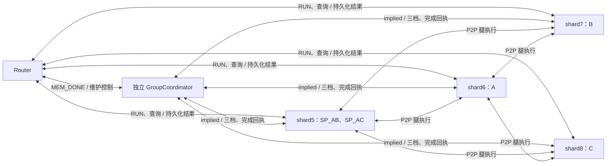
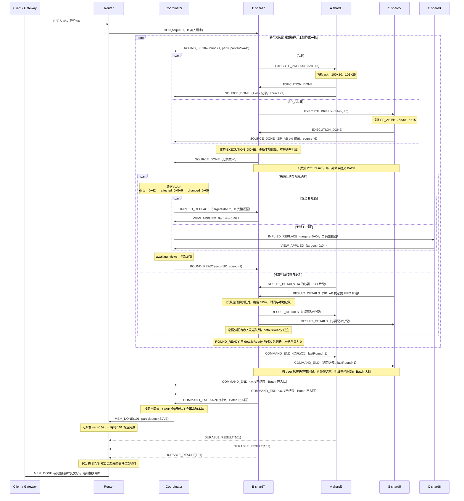

# Task 3：Router 直连、独立 Coordinator、三档推导与 P2P 成交

日期：2026-11-17；位图及消息传递说明更新于 2026-11-18。状态：已实现并进行正确性、压力和故障验证。代码与数据结构见 [05](05_implementation_and_data_structures.md)，实际测试口径、结果与耗时见 [06](06_validation_results.md)。

**Router 直接连接 S/A/B/C，按关联组排队并派发订单。独立 GroupCoordinator 维护五个合约的三档、计算 implied，确认整条命令内存及视图完成后向 Router 发送 MEM_DONE；Router 据此派发下一条，不等待 fsync。普通和 implied 命令的持久化结果都由实际参与 shard 直接返回 Router；Router 收齐本条 MEM_DONE 指定的实际参与者结果后再发布。**

本版在 Router 直连与独立 Coordinator 的基础上，加入来源不变的本地完成短路径、来源刷新与成交明细配对重叠，以及固定容量计算和三档更新的自适应编码。仅考虑 A−B、A−C，继续关联组串行执行；Task 2 的本地 Batch 顺序提交、双日志线程和结果重放机制继续沿用。重启、shutdown 恢复及组合成交记录见 [03 文档](03_restart_shutdown_recovery_and_trade_records.md)。

## 1. 范围与组件职责

| 组件 | 职责 |
| --- | --- |
| Router | 按原合约/订单归属直连目标 shard；分配组 seq、维护有界队列和一个组内执行名额；收到 MEM_DONE 后派发下一条；收齐实际参与者持久化结果后向 Gateway 发布 |
| 独立 GroupCoordinator（下称 Coordinator） | 汇聚真实三档，计算十二条 IN/OUT 规则；确认每轮/整条内存完成，向 Router 发送 MEM_DONE 及最终实际参与者集合；不汇总落盘结果 |
| S＝shard5 | 只持有 SP_AB＝A−B、SP_AC＝A−C 的真实簿，以及 Coordinator 下发的本片 implied 视图；上报两个合约的三档 |
| A/B/C＝shard6/7/8 | 各自持有真实簿与本片 implied；上报三档；按本地最优价位和 FIFO 执行 |
| 当前命令的发起 shard | 接收 Router 的 RUN，比较直接与 implied，选定本轮各 route 数量，发起 P2P 腿执行并报告本轮结果；判断是否继续下一轮；结束时通知全部实际参与者封闭结果 |
| 各片现有后台线程 | 继续负责订单日志、成交日志、快照及原有辅助工作，职责不变 |

Coordinator 是独立服务组件，首版按独立进程、单线程事件循环部署，复用现有网络设施；不在 Router 内运行，也不隶属于 S。它只保存派生价位摘要和内存执行进度，不拥有真实订单簿、不生成自己的交易日志。业务 shard 的状态线程和文件线程设计不变。

A、B、C、SP_AB、SP_AC 属于同一个关联组，因为 AB、AC 共享 A。组内新单、撤单及其他真实状态修改都由 Router 的同一组队列派发；shard1–4 等无关业务继续原有直连路由。BF_ABC 不参与推导。

Router 按接收顺序排队，整个关联组同时只执行一条外部修改命令，不能按四个 shard 各自放行。收到当前 seq 的 MEM_DONE 后才派发下一条；其间继续接收请求和旧命令的落盘结果，不等待 fsync。Coordinator 仍在内存完成的控制路径上，不能因普通结果直返而绕过它的视图确认。必须区分“一笔成交完成”“当前订单整条命令完成”和“结果已持久化”。

所有推导只读取**原生真实挂单**；正在处理的主动单尚未挂簿的部分，以及已有 implied，都不作为来源。真实与 implied 按 [04 的撮合优先级](04_matching_priority.md) 比较：价格优先，同价直接 FIFO 优先，再按到期顺序选择 implied；本版 B 早于 C 到期，因此同价 AB 优先于 AC。implied 不与 implied 成交。

## 2. 连接关系：Router 直连业务，Coordinator 负责同步与确认



| 长连接 | 用途 |
| --- | --- |
| Router ↔ S/A/B/C，各一条业务连接 | 直接派发 RUN、撤单和查询；接收各片持久化结果、查询响应及原 Drain/Drained |
| Router ↔ Coordinator，一条控制连接 | MEM_DONE 及维护就绪信息；不转发原始订单或成交结果，保留直连以免放行确认再经发起 shard 转发一跳 |
| Coordinator ↔ S/A/B/C，各一条控制连接 | 三档更新、implied 替换、轮次完成和整条命令结束确认，不接收落盘业务结果 |
| 5↔6、5↔7、5↔8、6↔7、6↔8 | 仅真实腿的 EXECUTE_PREFIX、执行确认及必要成交明细，不广播来源缓存 |
| 7↔8 | 本范围无需连接 |

Router 主动连接各 shard 及 Coordinator，Coordinator 主动建立各 shard 的控制连接，peer 对由较小 shardId 主动连接较大 shardId。复用非阻塞 reactor、缓冲与 TCP_NODELAY。Router 保留唯一业务上游角色；Coordinator 控制连接和 peer 使用独立端口/角色，不能进入原唯一上游入口而挤掉 Router。原有行情通道另行保留。

所有连接握手确认身份、协议版本、运行代次和配置标识。Coordinator 收齐五个合约的初始三档、向包括 S 在内的目标安装初始 implied，并确认 peer 就绪后，通知 Router 允许首次派发；初始化/恢复就绪与逐命令的 MEM_DONE 分开判断。恢复流程见 03。

### Router 的最小接入改动

1. 保留原合约归属、订单 ID 中的 shardId 和各 shard 业务连接。新单、按 orderId 路由的撤单直接发送所属 shard，不再增加 Coordinator 组后端。
2. 为 shard5–8 增加一个共同的有界 FIFO 和当前执行 seq。Router 分配组 seq，随 RUN 携带原 user/session/token 和客户端 payload；Coordinator 从 shard 的 ROUND_BEGIN/完成消息取得该 seq，不要求原订单先经过它。
3. Router 等待当前运行代次、当前 seq 的 MEM_DONE，不收集各片 SOURCE_DONE 或 VIEW_APPLIED。MEM_DONE 携带最终实际结果参与者集合；本范围用一个 shard 位图即可，普通命令通常一片，跨片通常三片，也可能四片。
4. 各实际参与者的 DURABLE_RESULT 均直返 Router，按 (groupEpoch, seq, shardId) 汇聚完整结果。Router 分别记录内存确认、预期参与者和已落盘集合；收齐指定成员而非任意三个回执后发布，旧命令仍待落盘不阻止下一条内存执行。
5. 查询继续按逻辑 shard 直接扇出、收齐结束标记；原上游连接/session/token 关联继续保留。组内查询在完整内存边界捕获，并遵守第 7.3 节与 03 的可见范围，不把查询扇出计入修改命令的多个执行名额。

Router 的超时和背压覆盖本地排队。暂停维护时，即使收到当前 MEM_DONE，也不能越过维护门禁派发；控制连接未就绪时不能让组内普通命令自行连续执行。客户端协议不增加 Coordinator 概念。

## 3. 来源缓存：只保存原生最优三档

### 3.1 保存什么

每个合约按买卖侧分别维护当前最优三个**价格档位**，不足三档则全部保存。每档仅需 price、该价位真实剩余总量；不关心该档由一张还是多张订单组成。另记录窗口外是否还有更深价位 hasMore。

Coordinator 缓存 A/B/C/SP_AB/SP_AC × 两侧 × 三档＝最多 30 个价位记录，使用固定容量数组及有效档数；S 与其他 shard 一样，通过三档更新上报自己的两个合约。Coordinator 不直接读取任何 shard 内存，不复制源 orderId、用户、FIFO 链表或成交历史。S 不再保存 A/B/C 的来源摘要。

数量使用价位累计量，不是订单笔数。只调整 FIFO 内部而价格/总量不变时，无需来源更新；具体订单选择留在真实订单所属 shard。

### 3.2 窗口移动与 delta／快照自适应选择

以 (symbolId, bookSide, price) 标识一个源价位，bookSide 表示被消耗的原生 Bid/Ask 一侧。

```text
DEPTH_SNAPSHOT：symbolId, bookSide, version, hasMore, levels[]
DEPTH_DELTA：   symbolId, bookSide, baseVersion, newVersion, hasMore, changes[]

SET_LEVEL：    price, totalRemaining
REMOVE_LEVEL： price
```

上述是逻辑字段；当前线协议将 `(symbolId, bookSide)` 合为一个 `source:uint8`，编号见第 4.1.1 节。正常轮次的 delta／快照记录直接装入 SOURCE_DONE，不另外发送来源位图；完成消息与来源记录的对应关系见第 4.1.2 节。

- SET_LEVEL 同时用于新档和数量更新，发送最终绝对量；零数量统一移除。
- REMOVE_LEVEL 表示从缓存窗口移除，可能是价位已空，也可能只是被新优价挤出三档，不代表撤销真实订单。
- 最优档耗尽时，原第四档进入前三档，发送新增档；新优价进入时，同时移除被挤出的旧第三档。
- 第四档以后的变化若未影响三档或 hasMore，不发送价位 payload。
- 一轮执行结束后比较新旧窗口，合并本轮同价位的多次变化，不逐笔 FIFO 成交发送网络更新；不跨命令合并。
- version 按合约、侧分别维护，只在窗口内容或 hasMore 改变时递增一。首次建立缓存用完整快照，空簿也明确发送空列表。

SET_LEVEL 不需要 orderVersion、arrivalKey 或源订单身份。hasMore 变化即使不伴随价位变化，也要发送新窗口版本。

**正常更新按完整编码长度选择 DEPTH_DELTA 或 DEPTH_SNAPSHOT，不固定使用 delta。** 发送方比较同一旧窗口与最终新窗口，只编码并发送较小的一种；长度相同保留 delta。比较包含各自的版本字段、记录数、操作码及消息封装，不只数改变了几档。三档快照的价量正文最多为 `3 × (4 + 8) = 36` 字节；连续换档时，删除旧档再新增新档可能比直接发送完整窗口更大。长度可按字段计算，无需为比较大小分配并编码两份报文。

两种编码表示同一次原子窗口更新，使用相同的 groupEpoch/seq/round 和最终窗口版本。delta 必须匹配 baseVersion；正常运行中的完整快照同样核对来源身份及预期的新版本，不能用快照绕过乱序／旧实例校验。初始化和恢复按接入代次安装完整快照。接收方在固定容量临时区完成整份更新、校验及排序后再安装；delta 先应用 REMOVE，再应用 SET，最终窗口最多三档，不暴露半份窗口。重复帧不能重复推进版本或完成计数。

窗口及 hasMore 均未变化时，两种价位 payload 都不发送，只走完成消息；满足第 5.3 节时进一步合并为 LOCAL_COMPLETE。选择完整快照不增加一次请求／回包，也不改变 SOURCE_DONE 的收齐条件。

### 3.3 何时更新

来源更新由主线程完成的真实内存修改驱动，包括新增、撤单、直接成交、implied 腿成交及主动单剩余量挂簿。**不等待对外 Trade 通知，不等待双日志落盘。**

正常轮次需要报告完成的 shard 由发起方明确声明，各片完成本轮真实扣量／挂簿和来源窗口更新后，向 Coordinator 发送选定的 delta 或快照及 SOURCE_DONE；三档无变化也明确完成。SOURCE_DONE 只证明本轮真实内存修改和来源更新完成，不证明成交明细配对完成、整条命令结束或 Batch 已入队。

来源腿在真实修改完成后即可报告 SOURCE_DONE，并向发起方发送 EXECUTION_DONE；必要 FIFO 成交片段通过 RESULT_DETAILS 继续传输。发起方收齐两腿 EXECUTION_DONE、完成本地真实修改和主动单数量更新后即可报告自己的 SOURCE_DONE，**不再等待逐单明细全部收齐或配对完成**。任一真实修改未完成时，不能以计划成交量代替执行完成报告。

Coordinator 按 ROUND_BEGIN 的名单收齐来源后，重算并同步 implied；与此同时，发起方接收两腿明细、按原选择顺序配对并分发必要成交分配。**发起方等待本轮 ROUND_READY 与本地 detailsReady 两项都满足，才判断继续撮合、挂簿收尾或结束。** detailsReady 的定义与有序发送规则见第 6.3 节；它是发起方本地状态，不新增 Coordinator 回执。两项任意先到都只记录进度，正常轮次仍不提交本单 Batch。本地完成短路径见第 5.3 节。

## 4. Coordinator 集中计算并完整替换相关 implied

### 4.1 十二条规则与更新范围

下表 bid/ask 均指原生价位。每条规则取两侧各自最优三档，按第 4.2 节逐层配对；数量指手数，不是实际订单张数。

| 目标 | implied bid | implied ask | bid / ask routeId |
| --- | --- | --- | --- |
| SP_AB（IN） | A bid − B ask | A ask − B bid | 0 / 1 |
| A，来自 AB（OUT） | SP_AB bid + B bid | SP_AB ask + B ask | 2 / 3 |
| B（OUT） | A bid − SP_AB ask | A ask − SP_AB bid | 4 / 5 |
| SP_AC（IN） | A bid − C ask | A ask − C bid | 6 / 7 |
| A，来自 AC（OUT） | SP_AC bid + C bid | SP_AC ask + C ask | 8 / 9 |
| C（OUT） | A bid − SP_AC ask | A ask − SP_AC bid | 10 / 11 |

| 变化来源 | 可能需要重算的目标 |
| --- | --- |
| A | B、C、SP_AB、SP_AC |
| B | A 的 AB 路径、SP_AB |
| C | A 的 AC 路径、SP_AC |
| SP_AB | A 的 AB 路径、B |
| SP_AC | A 的 AC 路径、C |

实现时将上述依赖细化到 `(symbolId, bookSide)`，预计算十个来源侧各自影响的 route 位图。每轮来源更新只标记变化来源，收齐名单后每条受影响 route 最多重算一次；不受影响的 route 保留原结果。十二条 route 各使用最多五段的固定容量数组和有效段数，复用计算及发送缓冲区；热路径不为来源／路径集合建立动态 map，也不逐轮分配这些小数组。目标完整视图仍包含其全部 route，变化判断覆盖价格、数量、more 和空集合。

#### 4.1.1 三种位图存在哪里

位图是整数中的集合标记：第 i 位为 1，表示编号 i 在集合中。它不保存价格、数量或订单，也不是另一份行情视图。三个阶段使用不同的编号空间，不能直接混用：

| 标记 | 类型与有效位 | 存储位置和生命周期 | 是否传到其他进程 |
| --- | --- | --- | --- |
| 来源变化 `dirty_` | `uint16_t`，低 10 位对应来源侧 | 独立 Coordinator 进程内的 `Coordinator` 对象成员；跨本轮多条 SOURCE_DONE 累积，在 `reset_round()` 开始新轮或整单完成时清零 | 不传；从收到的来源记录重建并累积 |
| 受影响规则 `affected` | `uint16_t`，低 12 位对应 routeId | Coordinator 调用 `recompute()` 时的局部变量，每次从 0 计算；不跨消息保存 | 不传；在本进程中决定哪些 route 需要重算 |
| 目标变化 `changed` | `uint8_t`，低 5 位对应目标合约 | `recompute()` 的局部结果，按值返回给 `Coordinator::finish_sources()`，再传给 `install()` | 按目标所属 shard 拆成子集后，以 `targets:uint8` 随 IMPLIED_REPLACE 发送 |
| 待确认目标 `awaiting_views_` | `uint8_t`，与 `changed` 使用相同 5 位 | `Coordinator` 对象成员；`install()` 保存本次目标集合，跨消息等待 VIEW_APPLIED 并逐次清位 | 整个待确认集合不发送；各 shard 回传自己已安装的 `targets` 子集 |

来源号为 `2 × slot + side`，Bid=0、Ask=1；目标位号直接使用 slot。这里的 slot 是组内固定编号，不是外部 symbolId 或 shardId：

| 合约 | slot／目标位号 | Bid 来源位号 | Ask 来源位号 |
| --- | --- | --- | --- |
| A | 0 | 0 | 1 |
| B | 1 | 2 | 3 |
| C | 2 | 4 | 5 |
| SP_AB | 3 | 6 | 7 |
| SP_AC | 4 | 8 | 9 |

依赖表 `dependencies` 定义在 [depth.hpp](../../src/matching_engine/spreads/depth.hpp)，是按十二条固定规则编译期生成的 `std::array<uint16_t, 10>`，数组内容共 20 字节。`dependencies[source]` 表示该来源影响哪些 route；运行时只查表和按位或，不逐轮构建依赖图、不通过网络分发这张表。例如 A ask（来源 1）对应 route 1、5、7、11，SP_AB bid（来源 6）对应 route 2、5。

`dirty_`、`awaiting_views_` 的成员定义见 [coordinator.hpp](../../src/matching_engine/spreads/coordinator/coordinator.hpp)，推导局部变量见 [depth.cpp](../../src/matching_engine/spreads/depth.cpp)。当前 `finish_sources()` 还计算一份局部 `affected`，只用于统计本轮重算条数；实际价格推导仍只在 `recompute()` 中执行一次。这些标记只服务内存轮次推进，不写入订单／成交日志 Batch。

#### 4.1.2 一轮内谁传给谁，在哪一步传

1. **shard 完成真实修改，向 Coordinator 发来源记录。** [Session::source_done()](../../src/matching_engine/spreads/session.cpp) 比较本地新旧三档及 hasMore，用一个局部来源位图挑出要编码的记录。这个局部变量也叫 `changed`，但它是 10 位来源集合，与上表的 5 位目标 `changed` 含义不同。它本身不进入报文；SOURCE_DONE 正文为 `记录数:uint8 + 各记录的长度:uint8及delta／快照内容`，每条记录内部含 `source:uint8`。无来源变化时仍发送记录数为 0 的 SOURCE_DONE，表示该 shard 本轮已完成。
2. **Coordinator 接收记录，累积 `dirty_`。** `read_sources()` 校验来源归属、重复记录及窗口版本，应用记录并返回这些来源号组成的位图；Coordinator 执行 `dirty_ |= 本次来源位图`，同时在 `done_` 中标记发送 shard 已完成。`done_`／`expected_` 是另一个 4 位成员集合，按 S/A/B/C 编号，用于收齐 ROUND_BEGIN 的名单，不能用 `dirty_` 代替。即使某片记录数为 0，也要等待它的完成报告。
3. **名单和报告齐全后，内部生成 `affected`。** ROUND_BEGIN 与 SOURCE_DONE 可跨连接先后乱序到达；只有名单已声明且 `done_ == expected_` 时，才汇总所有脏来源的依赖：`affected = 按位或 dependencies[每个脏来源]`。同一 route 即使被两个来源同时标记，也只有一位，只重算一次。
4. **重算后，内部生成目标 `changed`。** 对 `affected` 中每条 route，用最新来源推导并比较缓存 `views_[routeId]`。价格、数量、more 或空集合确有变化，才更新缓存并置该 route 的目标合约位；受影响不等于结果一定改变。一个目标的多个 route 改变也只占一位。`dirty_` 不在此处立即清零，随本轮保留到下一次 `reset_round()`。
5. **Coordinator 向各目标所属 shard 发视图和目标位图。** `install(changed, false)` 先令 `awaiting_views_ = changed`，再逐片计算 `own = changed & member_targets(member)`。`own != 0` 才发送 IMPLIED_REPLACE，正文首字节就是 `own`，随后为这些目标的全部 route 视图，包括未变化的 route 和显式的空 route。A/B/C 各负责一个目标；S 可在同一帧中携带 SP_AB、SP_AC 两个目标。子集仍沿用全组五位编号，不重新编号。
6. **目标 shard 安装后，向 Coordinator 回传目标位图。** `Session::control()` 校验并安装完整视图后，发送 VIEW_APPLIED，正文仅为收到的 `targets:uint8`；groupEpoch/seq/round 沿用公共头。Coordinator 核对发送者归属、轮次及待确认位，执行 `awaiting_views_ &= ~targets`。待确认位全部清零后向发起 shard 发 ROUND_READY；发起 shard 仍须另等本地 detailsReady。

第 5、6 步传输的 1 字节仅指目标位图，不是完整消息长度。来源位图、route 位图都不需要另加网络字段；目标位图则同时描述“本帧替换哪些合约”和“本帧确认哪些合约”，不逐个重复 symbolId。具体编解码见 [protocol.cpp](../../src/matching_engine/spreads/transport/protocol.cpp)，收齐和发送逻辑见 [coordinator.cpp](../../src/matching_engine/spreads/coordinator/coordinator.cpp)。

这条来源／视图链路全部走 **shard ↔ Coordinator 控制连接**，不经 Router，也不走两腿 P2P 明细连接。Router 另等整条命令的 MEM_DONE；VIEW_APPLIED 只确认内存视图安装，不表示 Batch 已封闭或结果已落盘。

正常轮次若 `changed == 0`，不发送 IMPLIED_REPLACE，也不等待 VIEW_APPLIED，来源收齐后直接返回 ROUND_READY。第 5.3 节的 LOCAL_COMPLETE 进一步跳过整个普通轮次。初始化／重接入则按第 2 节强制为需要重新安装的目标发送完整视图，即使与 Coordinator 的旧缓存相同，也不能套用正常轮次的“未变不发送”。

### 4.2 三档总量取 min，最优价位逐层配对

每个 route 固定目标合约/方向、两个源合约/侧及价格公式。对本版 1:1 路径，记两份三档窗口的数量之和为 T1、T2，本轮生成的 implied 总量为：

```text
Q = min(T1, T2)
```

将两个来源分别按本侧最优到最差排列：Bid 从高到低，Ask 从低到高。两个游标从首档开始，每次取当前两档剩余量的 min，按 route 公式生成一段 implied；虚拟扣减两边数量，哪边当前档耗尽就只推进哪边，直到某一侧三档用完。不会按第 1/2/3 档机械地一一对应，也不枚举所有档位组合。

例如由 SP_AB 买盘和 A 卖盘推导 B 卖盘：

| 来源档位 | SP_AB bid：价格 × 数量 | A ask：价格 × 数量 |
| --- | --- | --- |
| 1 | 6 × 30 | 100 × 20 |
| 2 | 5 × 40 | 101 × 40 |
| 3 | 4 × 30 | 102 × 60 |
| 三档总量 | 100 | 120 |

生成 B 的 implied asks：**94 × 20、95 × 10、96 × 30、97 × 10、98 × 30，共 100 手**。A 窗口余下的 20 手不额外生成 implied；上述计算不修改真实订单。一条 implied 表示一个价位数量段，不是一张源订单。

两边分别有 m、n 个非空档时，最多生成 m+n−1 个配对段；三档对三档最多五段。相同目标价格可合并展示，但保留所属 route；三档来源不等于最多三个 implied 价格。

Coordinator 下发的视图按 route 分组：

```text
routeId, more, levels[(impliedPrice, quantity)]
```

不发送源 orderId、两腿价格配方或 FIFO 索引。more 表示消耗本 route 当前 Q 手后，两侧是否仍可能提供后续来源：
`more = (T1 > Q 或 source1.hasMore) 且 (T2 > Q 或 source2.hasMore)`。目标耗尽该 route 前缀且 more 为真时，先补档刷新，再决定后续成交。

A 的 AB、AC 两条 route 分别生成有序序列，再按目标价格和 04 的来源优先级合并。实际选中的每条 route 必须是自身序列从最优开始的前缀。同一来源仍可能支持其他目标的报价，因此跨目标展示量不能相加为独立库存；组内串行执行和每轮刷新防止重复消耗。

### 4.3 完整替换，不逐个维护 implied ID

Coordinator 为受影响目标重新生成按 route 分组的价位集合，通过 IMPLIED_REPLACE 一次替换该合约的全部 implied 买卖视图；A 的集合同时包含 AB、AC 路径。实际未变化的集合可以不发送；候选清空时必须发送空集合。

包括 S 在内的接收方收齐整份更新后，在状态线程中安装新集合，再向 Coordinator 回复 VIEW_APPLIED。替换不涉及真实簿，不改变源订单 FIFO；implied 的重建时间不作为新时间优先级。各目标无需逐个新增/删除虚拟订单，也不反向广播收到的 implied。

三档指来源缓存和推导窗口；对外行情接口仍按 Task 3 输出最多五档合并价格，不能把三档来源机械地截成三个 implied 价位。quantity 为直接数量，impliedQuantity 为当前窗口逐层配对生成的数量，两者不重叠。numOfOrders 为该价位真实订单数加正数量 implied 路径价位条数；同 route 同价合并算一条，不代表源簿实际订单张数。

## 5. 价位 P2P 成交与大单补档

### 5.1 正常执行：每条 route 只发成交总量

来源不会被另一条关联命令修改，因此本版不采用 02 的 PREPARE/FROZEN/ABORT 争抢流程。前提是前一轮视图完整，本轮来源状态未被其他写入改变，并且选中的是每条 route 自最优开始的连续前缀。

发起 shard 比较直接盘与各 route 的 implied 价位，按限价和既定优先级选择，再将每条 route 选中的多档数量合并成一个 q。每条 route 的 q 不超过其 Q；各 route 的 q 与本轮直接成交量合计不超过主动单剩余量。两条真实腿各执行同一个 q，不能把 q 任意分成两腿不同数量。

本版 A 的两条 OUT 路径分别消耗 SP_AB/B 与 SP_AC/C，源侧互不重叠；A 被不同目标引用的冲突由关联组串行执行排除。这是两腿各自执行相同最优前缀的基础。

每个源 shard 根据 routeId 和自身身份确定源合约、Bid/Ask 侧，从该侧最优价位开始逐层取量；价位内部仍按 FIFO 处理真实订单，直到累计完成 q。这是执行已选定前缀，不是重新做一次普通新单撮合；不能跳档、越过本轮三档容量或自行改走其他 implied 路径。

以上例 B 买入 45 手为例：B 选择 94 × 20、95 × 10、96 × 15；分别向 A、S 发送该 route 的 q=45。A 本地消耗 100 档 20、101 档 25；S 本地消耗 6 档 30、5 档 15。两腿自行选择实际订单，无需传逐档成交价格或源 orderId。

正常执行允许部分消耗一个 implied 价位，但源 shard 应完整执行本次确定的 q，而非自行缩量。成交后的三档余额重新汇聚 Coordinator，按新的 min(T1,T2) 重算替换。仅凭“数量”不能区分 AB、AC，因此保留一个 routeId；合约和买卖方向均由它推导，无需重复发送。

### 5.2 大单循环：先刷新并判断，再结束整条命令

```text
Router 按组排队，直接向目标 shard 派发 RUN(seq)
    → 满足第 5.3 节本地完成条件：
        本片封闭完整 Batch 入队 → LOCAL_COMPLETE → Coordinator 核对 → Router：MEM_DONE
    → 其余命令走正常轮次：
        发起 shard 声明 ROUND_BEGIN(round, participants)
        → 本地执行，并 P2P 请求两腿执行 routeId + q
        → 真实修改完成后，两条进度重叠推进：
            来源／视图：delta 或快照 + SOURCE_DONE → 重算 implied → VIEW_APPLIED → ROUND_READY
            成交明细：RESULT_DETAILS → 按原选择顺序配对 → 必要分配有序发出 → detailsReady
        → 发起方等 ROUND_READY && detailsReady，再检查剩余量、限价及最新盘口：
            仍可成交 → 同一 seq，进入下一 round
            不能成交且还有剩余 → 按原规则挂簿，完成来源／视图收尾轮
            全部成交或收尾完成 → 通知所有累计实际参与者 COMMAND_END
        → 各片检查明细完整，封闭 Result 交原双日志队列，再向 Coordinator 确认 COMMAND_END
        → Coordinator 收齐全部实际参与者的结束确认 → Router：MEM_DONE
    → Router 可派发下一单；本条在后台完成双日志后再通知用户
```

正常轮次不在 ROUND_BEGIN 预先声明 final。**是否继续由发起 shard 在 ROUND_READY 和 detailsReady 均满足后判断**：剩余量为零则结束；否则用最新直接盘及 implied 按原限价/优先级选择下一轮。Coordinator 只确认来源／视图，不替发起 shard 判断明细是否配对完整或订单是否还能成交。原 orderId、限价和剩余量保留在发起 shard，Router 不重发这张大单。

三档是滚动窗口，不是整条命令的成交深度限制。当前 route 的数量前缀耗尽且 more 为真、主动单仍有剩余时，停止本轮选择，先执行并补档刷新再判断；不能把未加载深度当成空簿，也不能让直接盘或另一 route 越过补档先成交。完整的跨来源选择顺序见 04。

如果新视图已证明没有可成交价格，剩余量按原规则挂簿；挂簿产生的新三档和 implied 变化也要完成一个收尾轮。该轮可以没有新成交，此时 detailsReady 立即成立，但仍要等 ROUND_READY 后才能结束；已挂簿的剩余量不作为新主动单再执行一次，也不等待未来订单到来。已经进入正常轮次的命令不在后续收尾时改走本地短路径。

整条命令的实际结果参与者是各轮参与者的并集。只在早期轮次成交过的 shard 也要收到最终结束通知、封闭自己的累计 Result。**所有撮合轮次及挂簿收尾的 implied 更新完成后，每个实际参与 shard 才将本条完整结果封闭为一个本地 Batch。** 一旦开始结束阶段，不再发送该 seq 的下一轮执行。

### 5.3 来源不变的本地完成短路径

发起 shard 可在发送首个 ROUND_BEGIN 前，本地判断并完成整条命令；仅当以下条件全部成立时，使用 LOCAL_COMPLETE：

1. 组和连接处于正常就绪状态，命令使用上一完整边界已安装的 implied；整条命令只涉及本片，未发送任何 EXECUTE_PREFIX 或普通轮次消息。
2. 按直接／implied 统一优先级确认本单已经结束，没有后续成交、补档或待挂簿余量；本地真实结果和业务事件均完整。
3. 命令前后，本片受影响合约的 bid/ask 三档完全相同：有效档数、各档价格与数量、hasMore 均不变，因此来源 version 也不变。S 同时覆盖本次涉及的两个价差合约，不能只检查其中一个。
4. 结果预算和入队容量允许，完整不可变 Batch 已交原双日志队列。

典型例子是撤销第三档之外的订单，且没有改变 hasMore；或者新单最终挂在三档以外，且没有改变 hasMore。**没有 implied 成交不等于符合短路径**：普通直接成交、挂单或撤单只要改变来源窗口，就仍需走正常同步。

本片发送一条 LOCAL_COMPLETE，公共头标识 groupEpoch/seq，round=0 表示未进入普通轮次，正文只携带 localBatchSeq。发送连接已确定 shard 身份，因此不重发单元素参与者名单、来源版本列表或三档。此消息合并本地参与者声明、来源未变及整单已封闭确认；不再单独发送 ROUND_BEGIN、SOURCE_DONE、COMMAND_END，也不等待 ROUND_READY。

Coordinator 核对运行代次、来源连接、命令序号和就绪状态，确认该 seq 没有普通轮次或其他参与者后，直接向 Router 返回 MEM_DONE，实际参与者仅为发送片。重复消息不能重复封闭 Batch 或重复放行；校验不通过时不放行。这样省去一次 Coordinator ↔ 发起 shard 的往返，仍不绕过 Coordinator 或原持久化发布条件。

短路径只省略本次无需发生的来源／implied 同步；真实订单变化、成交和业务事件照常持久化。三档未变仍可能改变真实五档行情，本片仍须捕获相应完整候选并等待原公开许可。若本地判断不满足条件，则沿正常轮次继续，复用已经形成的命令上下文与结果，不能重新执行已经完成的本地修改。

## 6. 内部网络协议与信息传递

以下定义正常路径的消息语义和必要字段，具体枚举值及二进制偏移在实现时固定；不使用 JSON 作为热路径协议。

### 6.1 公共标识与封装

- 关联组运行代次 groupEpoch、Router 分配的外部命令 seq，以及命令内 round 放在公共头；seq 不替代本片 localBatchSeq，也不同于现有请求 token。
- 每个接收方每轮接收一个完整执行批次，每条 route 只出现一次；(groupEpoch, seq, round, routeId) 关联主动单与两腿执行，无需逐段 itemId 或持久 implied ID。轮次只负责来源/视图同步，整条命令通过结束确认收尾，不携带预判的 final 标志。
- IMPLIED_REPLACE 的 viewStamp 使用生成它的 (groupEpoch, seq, round)。未变化的集合保留原 stamp，不要求每片每条命令都收到新视图。
- routeId 使用 1 字节（本范围十二条规则）；价格沿用有符号整数，价位和 implied 累计量使用 uint64。执行量 q 沿用当前单张订单的 32 位数量上限，以 uint32 编码并校验有效范围，不能截断价位累计量。
- 来源窗口 version 使用 uint64，档数、变化条数和 SET／REMOVE 操作码各用 uint8，hasMore 放入单字节标志。三档快照每档只编码 price:int32 与 quantity:uint64；同一来源侧的合约、方向及版本只出现一次，不逐档重复。内存结构体的对齐填充不进入报文。
- 使用带长度的二进制帧和明确消息类型；批量列表有记录数。大消息分帧时携带分段编号/结束标记，收齐前不安装半份视图或宣布结果完整。
- 原 EngineLinks 的固定消息校验与 max_link_frame 不直接容纳这些列表，需要新增内部类型、长度上限及编解码；沿用现有客户端字段语义和请求关联。

### 6.2 消息表

| 消息 | 方向 | 内容及完成含义 |
| --- | --- | --- |
| RUN | Router → 发起 shard | seq、原请求上下文；Router 按组排队，仅派发当前获准执行的命令 |
| ROUND_BEGIN | 发起 shard → Coordinator | round、participants；声明本轮需收齐的 SOURCE_DONE，Coordinator 累计各轮参与者并集 |
| EXECUTE_PREFIX | 发起 shard → 两腿所属 shard | 首次请求携带命令上下文；执行项只有 routeId、q，两腿各自从最优价位完成 q |
| EXECUTION_DONE | 腿所属 shard → 发起 shard | 本轮该接收方整个执行批次的真实修改已应用；可早于完整 RESULT_DETAILS，不回传逐单列表或重复请求字段 |
| RESULT_DETAILS | 发起 shard ↔ 腿所属 shard（确需时） | 源实际成交片段和必要配对分配，与来源／视图更新重叠；按 seq/round/route 关联，不进入 Coordinator 来源缓存 |
| DEPTH_SNAPSHOT / DEPTH_DELTA | S/A/B/C → Coordinator | 第 3 节的来源记录编码，按完整编码长度选择较小的一种；正常轮次装入 SOURCE_DONE，S 可同帧携带多个变化来源侧 |
| SOURCE_DONE | 本轮声明的参与者 → Coordinator | 正文为变化来源记录数及记录，不另带 `dirty_`；本轮真实修改及来源更新已完成，不等待明细配对；无三档变化也发送记录数 0，此时不提交本单 Batch |
| IMPLIED_REPLACE | Coordinator → 目标所属 shard | 正文为 `targets:uint8` 及这些目标的完整 route 分组；viewStamp 在公共头中，空 route 以档数 0 明确编码 |
| VIEW_APPLIED | 目标所属 shard → Coordinator | 正文为已完整安装的 `targets:uint8`，公共头对应 viewStamp；S 可确认一个或两个合约，不以 shard 回执替代目标位 |
| ROUND_READY | Coordinator → 发起 shard | 本轮来源及必要视图已完成；发起方另等本地 detailsReady 后，才决定继续成交、挂簿收尾或结束 |
| COMMAND_END（通知） | 发起 shard → 累计实际参与者 | seq、最后完成的 round；整条命令不会再有执行，各片明细齐全后封闭 Result 入队，本片本地处理 |
| COMMAND_END（确认） | 每个实际参与者 → Coordinator | seq、最后完成的 round、localBatchSeq；本片不会再追加本条结果，完整 Batch 已入队，不代表落盘 |
| LOCAL_COMPLETE | 发起 shard → Coordinator | 仅第 5.3 节：round=0、localBatchSeq；整单本地完成、来源未变、完整 Batch 已入队，合并声明及结束确认 |
| MEM_DONE | Coordinator → Router | 正常路径已同步最终视图并收齐 COMMAND_END，或已核对 LOCAL_COMPLETE；携带 seq 和最终参与者，允许下一单 |
| DURABLE_RESULT | 所有实际结果参与者 → Router | seq、localBatchSeq、提交边界和完整业务事件；本片双日志已完成，按来源 shard 归属，分帧以最终段为准 |

Coordinator 不猜要收多少，而是按明确的名单收齐：

| 等待阶段 | 名单来源 | B 买入 45 手例子 | 完成消息 |
| --- | --- | --- | --- |
| 本轮来源完成 | 发起 shard 的 ROUND_BEGIN；由本轮实际执行的 route 和本地修改确定 | S/A/B | SOURCE_DONE |
| 新 implied 安装 | Coordinator 本轮实际下发的 (targetSymbolId, viewStamp) 集合 | B、C 两个目标视图 | VIEW_APPLIED |
| 本轮明细配对 | 发起方选中的 route 及其来源片段；只在发起方检查 | B 收齐 A/S 片段、配对并有序发出必要分配 | 本地 detailsReady，不新增回执 |
| 整条命令结束并入队 | 各轮真实参与者并集，包含发起 shard | S/A/B，C 只安装视图 | COMMAND_END（确认） |
| 对客户端发布 | Coordinator 的 MEM_DONE 给出整条命令实际参与者，Router 收集落盘结果 | S/A/B，C 不写日志 | DURABLE_RESULT |

参与者名单可用四位 shard 位图表示；回执按身份置位，重复消息不能增加完成数量。视图按目标合约及 stamp 核对：S 管理两个合约，收到其中一个视图的确认不能代表两个都完成。ROUND_BEGIN 与 SOURCE_DONE 即使跨连接乱序抵达，也必须等名单及名单内所有报告齐全；无 delta 不代表没有完成报告。

Coordinator 检查 S/A/B/C 上所有受影响的 IN/OUT，但只向内容变化的目标发送替换；变空也要发。未变视图无需确认，空的发送集合可直接视为安装完成。每轮收齐后返回 ROUND_READY，不等待或接收成交明细；发起方还须等 detailsReady。正常路径只有发起方决定不再继续、所有累计参与者均确认 COMMAND_END 后，才直接向 Router 发 MEM_DONE，不再下发 FINALIZE 或等待 fsync。LOCAL_COMPLETE 的单片集合由发送身份确定，按第 5.3 节直接核对，不建立普通轮次的等待集合。

COMMAND_END 在 peer 连接上是发起方的结束通知，在 Coordinator 控制连接上是各片的结束确认，含义由连接角色和方向区分。后者必须在完整 Batch 入队后发送。正常路径的 SOURCE_DONE 发生在视图刷新和可能尚未完成的明细配对之前，不能同时证明整单封闭；不能把它与 COMMAND_END 合成一个提前回执。第 5.3 节的 LOCAL_COMPLETE 仅用于来源不变且整单已经本地封闭的独立短路径。Coordinator 按最后 round 和参与者身份核对，不能收到第一片的结束确认就放行。

### 6.3 执行请求与回包

同一命令向某个参与 shard 的首次请求携带主动单 orderId、用户和必要请求关联；后续轮次按 seq 引用已建立的上下文。routeId 已确定目标及两条腿，接收方根据自身 shardId 判断负责哪一腿，不另发 legRole、合约名或买卖方向。

```text
EXECUTE_PREFIX 执行项：
    routeId : uint8
    q       : uint32
```

每项净 payload 为 5 字节，不包含公共帧头、记录数和首次上下文。采用明确字段编码而非带填充的原生结构体。q 是成交手数，不是要取多少张订单。

正常成功时 EXECUTION_DONE 只确认本批所有执行项的真实修改已全部应用；发送方已知道每项价格序列和 q，无需再回显。源 shard 保留必要的不可变 FIFO 成交片段，供后续配对分配引用；不能因已发 SOURCE_DONE 或 EXECUTION_DONE 就丢弃尚未完成的片段。逐单结果不用于 implied 维护，也不发给 Coordinator。

省略控制回包中的订单列表不等于省略真实成交记录。现有 TradeRecord 所需的买卖订单/用户等信息仍须正确生成；RESULT_DETAILS 按 03 传必要的 `(orderId, userId, price, quantity)` 片段和配对分配，同一信息只传必要的一次。客户端事件仍走原有持久化结果路径，不重复放入执行确认帧。

发起方的 **detailsReady** 是本轮本地汇合条件：所有选中 route 的必要来源片段已完整收到并校验总量，按原有序选择计划及源 FIFO 配对完成，fillNo／共同时间和本地记录已确定，发往参与者的必要分配已进入对应 peer 的有序发送队列。无远端明细的本地轮次在本地结果完成时即可置位。ROUND_READY 与 detailsReady 可以任意先后到达；任一未满足都不能进入下一轮或发送 COMMAND_END。

为避免新增逐轮明细 ACK，每个 peer 上的分配帧必须排在发往该 peer 的下一轮 EXECUTE_PREFIX 或最终 COMMAND_END 之前；接收方按连接顺序应用完整分配，再处理后续执行／结束消息。分帧包含轮次和结束标记，未收齐不视为明细完整。detailsReady 不声称所有远端已经安装分配，最终各片仍须在收到 COMMAND_END、确认自己所有轮次明细完整且 Batch 入队后才回结束确认。连接中断沿原故障流程处理，不能把“已进入发送队列”当作远端完成。

### 6.4 发送策略

1. 每个源 shard 的三档更新只向 Coordinator 发一份，各来源侧按编码长度选择 delta 或完整快照。S 同帧携带 SP_AB、SP_AC 中实际变化的部分；ABC 之间和 S 与 ABC 之间不广播来源缓存。
2. 同 route 多档数量合并成一个 q，再按接收 shard 打包并行 P2P 执行。Coordinator 不转发两腿执行请求或逐单成交明细。
3. routeId 在 implied 输出中按组发送一次，组内只放价格与数量；EXECUTE_PREFIX 不重复发送源价位、目标价位或买卖方向。
4. 同轮价位变化归并为最终绝对量；SOURCE_DONE 可附在发往 Coordinator 的最后一帧来源更新上，无变化时只发短完成标记。正常轮次的来源／视图与明细配对重叠推进，两项齐全后才继续；整单结束后才提交本单 Batch。
5. 发起方到 Coordinator 的 ROUND_BEGIN 可与该片本轮控制信息合帧；但发往其他 shard 的 P2P 执行请求是不同目的地，不与它假定为同一网络包。不人为等待凑帧。
6. Coordinator 仅替换受影响目标的完整小视图，未变目标不发 payload、不等待安装回执。发起方只在最终 ROUND_READY 与 detailsReady 均满足、判定整单结束后发送 COMMAND_END；若最后一帧必要分配尚在本地发送缓冲，可与结束通知同帧发送，但分配在前，不能为合帧提前结束。Coordinator 收齐实际参与者的 COMMAND_END 确认后直接 MEM_DONE，所有 DURABLE_RESULT 仍只发 Router。
7. Coordinator–shard 控制连接复用视图和完成回执；普通业务走 Router–shard。队列有界；普通请求/回包减少转发，但下一单增加 Coordinator → Router 的放行确认，不能据此直接承诺吞吐或延迟改善。
8. 严格满足第 5.3 节时仅发 LOCAL_COMPLETE，不再发送普通轮次的声明、来源完成和结束确认；此短路径不重传未变化的三档，也不增加一轮探测请求。

## 7. 结果封闭、下一条命令与用户通知

### 7.1 保留 Task 2 的文件线程

一条命令先直接成交、随后也可能成交 implied，最终参与者必须覆盖全部轮次，不能提前把前半部分当作普通命令发布。普通挂单、撤单、同簿直接成交通常只有本片一个实际结果参与者；只刷新 implied 的 shard 不在其中。

正常轮次只修改工作内存并累计 Result。发起 shard 收到最终 ROUND_READY、detailsReady 已成立，确认全部成交或剩余量已挂簿且收尾视图已同步后，向所有实际参与者发送 COMMAND_END：含义是“这张订单不会再继续执行，可以封闭整条结果”。各片确认本条明细齐全，将同一个完整、不可变的 Batch 提交给现有订单/成交日志线程，再向 Coordinator 发送 COMMAND_END 确认。正常路径的单片命令在本地封闭后直接确认。

**正常路径的本单 Batch 必须等全部撮合轮次及收尾 implied 刷新完成、必要明细齐全后才入队。** 即使本例 45 手已经全部成交，也等最终视图同步及明细配对后才结束；重叠执行不增加中间轮次提前写盘分支。日志线程仍可以写此前已结束命令的 Batch。第 5.3 节来源不变的本地命令无需发生新的视图同步，整单完成并封闭入队后通过 LOCAL_COMPLETE 确认；两条路径都只生成一个完整本地 Batch。

Coordinator 收齐全部实际参与者的结束确认，或核对本地短路径的 LOCAL_COMPLETE 后，直接 MEM_DONE，不再发一次 FINALIZE。此时 Router 可以派发下一单，不等待 fsync；本单客户端事件仍等实际参与者全部 DURABLE_RESULT。已封闭 Batch 不再追加，implied 不写日志，现有零成交批次不写空成交帧等行为继续保留。

实现时仍需让 DurableEngine 支持多轮累计后统一封闭；双日志线程、自然合批 fsync、完成位、快照线程和结果重放职责不变，pending/COW 及单命令结果预算继续有效。

### 7.2 两个放行条件

| 动作 | 条件 |
| --- | --- |
| 判断正常命令是否继续 | 本轮 ROUND_READY 与发起方本地 detailsReady 均成立，再检查剩余量及最新盘口 |
| 正常路径各片封闭本单 Batch | 最终 ROUND_READY 和 detailsReady 后，发起方确认没有后续执行／收尾，并通知 COMMAND_END；本片真实结果及必要明细完整 |
| 本地短路径封闭并确认 | 第 5.3 节全部条件成立，完整 Batch 已入队，本片发送 LOCAL_COMPLETE，不经历普通轮次 |
| Coordinator 发出 MEM_DONE | 正常路径最终视图已同步、累计实际参与者全部确认 COMMAND_END；或已核对 LOCAL_COMPLETE，直接发送 |
| Router 派发下一条关联命令 | 收到当前运行代次、当前 seq 的 MEM_DONE；容量允许且不在维护暂停中 |
| 某片推进本地 committed_ | 继续按本地 Batch 顺序，由原 poll() 确认 done == 3 |
| Router 发布本条业务事件 | 本条 MEM_DONE 已收到，且其中指定的每个实际参与者都已直返完整 DURABLE_RESULT |

MEM_DONE 不等待 fsync。Router 分开保存当前内存执行 seq 和此前待发布结果：持久化结果先到则按来源暂存，MEM_DONE 先到则可以派发下一单并继续等待旧结果。最终参与者以 MEM_DONE 为准，重复或分段回包不能重复计数，未指定的 shard 不能补足缺少成员。Coordinator 只汇总内存进度，不再维护待落盘结果表；Router 保留实际参与者及各片提交边界用于发布和恢复核对。

普通挂单、撤单、同簿直接成交只等待本片日志，包括 SP_AB 或 SP_AC 本簿的直接成交；来源发生变化时，其 MEM_DONE 仍需等待相关 implied 安装，来源不变且整单本地完成时才使用 LOCAL_COMPLETE。AB 单一路径通常涉及 S/A/B；一条 A 命令同时使用 AB、AC 时可能涉及 S/A/B/C，按实际集合等待，不硬编码三个 shard。

不同命令的业务通知仍独立判断，不新增全局提交日志或全局通知前缀。若后一条单片命令已满足自身条件，Router 可以先于尚未收齐远端日志结果的前一条跨片命令通知用户。

### 7.3 内部视图与公开数据

implied 内存可领先落盘，供后续命令使用。所有业务结果走实际参与 shard → Router → Gateway → client；Router 核对本条 MEM_DONE 与实际参与者的完整持久化结果后统一发布，Coordinator 不转发成交结果。行情仍由状态所有者在完整命令边界复制真实/implied 合并快照，按 Router 确认的公开边界取得发布许可后交原快照邮箱，不能混用不同边界的真实/implied 状态。

现有活动订单查询的捕获/等待机制、成交历史读取与索引继续沿用 Task 2；组内查询由 Router 直接转交逻辑 shard，在完整内存边界捕获，回包直返 Router。Router 维护可见边界，按 03 的规则限制历史查询与行情发布；Coordinator 不转发查询正文、不拥有订单/成交 ID，也不新增 implied 持久化文件。

## 8. 性能判断与验证重点

每条规则使用两个价位游标，复杂度 O(m+n)，三档对三档最多五个配对段。十二条规则在价格合并前最多六十段，Coordinator 来源缓存最多三十个价位；不扫描远程订单，不枚举 3×3 笛卡尔积，不建立订单级依赖图。A 的两条 route 以已有顺序合并，计算规模在当前范围内有固定上限。

整笔成交不是常数时间：真实价位定位取决于本地索引，FIFO 扣量和结果生成随实际订单数 F 增长，大单还可能经历多轮网络往返。主要测量 Router 排队、Coordinator 计算及 MEM_DONE 通知时间、命令到内存完成的延迟、P99、每命令轮数、网络字节数、真实成交订单数和等待落盘时间；另外记录短路径命中率、视图／明细两条进度的完成时间，以及 delta／快照选择后的实际字节数，不预先承诺性能倍数。

实现时重点验证：

- Router 直连各逻辑 shard；新单/撤单共用一个组内执行名额，查询按完整边界转交且不重复执行；无关 shard 路由不变。
- S 与 ABC 同样上报三档、安装 implied；Coordinator 缓存五个合约，不在 S 留下远程来源副本。
- 三档进入/退出、数量变化、空簿、hasMore 变化均正确；深层无关变化不产生多余 payload。
- 同一窗口变化用 delta 或完整快照还原出相同结果；比较完整编码长度、相等时保留 delta；完整换档、空簿和仅 hasMore 改变均正确，旧版本及重复帧不推进状态。
- 固定数组有效档数／段数不越界；按来源侧置脏并在收齐后每 route 至多重算一次，未变 route 和目标不增加 payload 或安装等待。
- 两份来源收齐后才刷新；每条 route 生成总量等于两边三档总量的 min，逐层推进正确，来源剩余量不重复计量。
- 示例 100/120 手生成 100 手、五段报价；部分成交 45 手只发送 routeId＋q，两腿实际价位消耗与前缀一致。
- A 的 AB、AC 路径按规则共同选择；同价合并仍能区分执行来源，允许真实与真实、真实与 implied 成交，禁止 implied 与 implied 成交。
- 大单滚动补档，不能提前让下一条命令进入，也不能跳过未补齐的更优 implied。
- 每条 route 只执行最优前缀；来源按最优价位逐层、档内 FIFO 扣量，不跳段、不越过当前三档计划，源订单身份不进入远程缓存。
- 空 implied 替换能清理旧候选；more 与各来源 hasMore/窗口剩余量一致；无变化目标不增加等待。
- EXECUTION_DONE 保持批次确认；必要真实成交明细不漏、不重复，不能以减少网络字段为由破坏日志或通知内容。
- ROUND_READY 先到或 RESULT_DETAILS 先到均正确；必须等 ROUND_READY 与 detailsReady 两项成立才继续，分段明细未收齐不能置位，配对分配按 peer 顺序先于后续执行／结束处理，不按回包顺序生成 fillNo。
- 深层挂撤单且三档／hasMore 不变时只发送 LOCAL_COMPLETE；hasMore 改变、已发送 P2P 或已进入普通轮次时不能走短路径；短路径仍正确写日志、生成事件和捕获五档候选，重复完成消息不重复放行。
- MEM_DONE 后 Router 可在磁盘未完成时派发下一条；所有结果直返 Router，结果先到时不提前发布；普通一片、跨片三片或四片按最终集合收齐，视图参与者不写日志。
- 正常路径多轮和挂簿收尾的 implied 全部同步、必要明细完整后才封闭，每片一个 Batch；SOURCE_DONE 不代表入队；实际参与者 COMMAND_END 确认全齐后直接 MEM_DONE，不能漏掉早期轮次参与者。LOCAL_COMPLETE 仅按第 5.3 节合并已完成的单片确认。

## 9. 后续边界与依据

本文定义正常运行的执行顺序、数据流、协议内容及持久化放行接口；本次优化后的轮次汇合与本地短路径以第 3.3、5.3、6.3 节为准。[03 文档](03_restart_shutdown_recovery_and_trade_records.md) 的成交事实及恢复要求、[04 文档](04_matching_priority.md) 的价格／FIFO／路径优先级继续适用。03 补充重启、shutdown 接入、连接重建和组合成交历史，并明确紧急中断时未完成跨片尾部的边界；不据此声称内存 P2P 执行已经解决跨片故障原子性。本文不保留旧“各目标复制远程源订单”的恢复步骤。

实现依据：[撮合核心](../../src/matching_engine/core/engine.hpp)、[持久化执行](../../src/matching_engine/persistence/durable_engine.cpp)、[现有连接封装](../../src/shared_data/orders/engine_link.hpp)、[Router 路由与回包](../../src/matching_engine/cluster/router.cpp)、[引擎网络入口](../../src/matching_engine/runtime/server.cpp)、[Task 2 双日志与快照](../task2_recovery/11_orderbook_delta_snapshot_consistency.md)。

交易行为仍以 [Task 3](../../task3.md)、[CME Implied Orders](https://cmegroupclientsite.atlassian.net/wiki/spaces/EPICSANDBOX/pages/457095346/Implied%2BOrders) 和 [Futures Implied Order Matching Priority](https://cmegroupclientsite.atlassian.net/wiki/spaces/EPICSANDBOX/pages/457096650/Futures%2BImplied%2BOrder%2BMatching%2BPriority) 为依据。本方案是项目的通信与计算实现选择，不要求采用 CME 的线协议，也不引入完整 Calvin 架构。


## 10. 完整例子：B 买入 45 手后，消息怎样流转

### 10.1 成交前的真实簿与 implied

沿用第 4 节的数量，并增加一张 SP_AC 买单，用来说明“只更新 implied”的 C 为什么无需落盘。以下均为价格档累计手数，不代表订单张数；假设没有更深档位，其余原生买卖侧均为空，初始 implied 已安装。

| 真实来源 | 当前价格 × 手数 |
| --- | --- |
| A ask | 100 × 20、101 × 40、102 × 60 |
| SP_AB bid（在 S） | 6 × 30、5 × 40、4 × 30 |
| SP_AC bid（在 S） | 10 × 100 |

Coordinator 已据此生成：

| 目标 | implied asks |
| --- | --- |
| B：A ask − SP_AB bid | 94 × 20、95 × 10、96 × 30、97 × 10、98 × 30，共 100 手 |
| C：A ask − SP_AC bid | 90 × 20、91 × 40、92 × 40，共 100 手 |

此时客户端发送 **B 买单，限价 96、数量 45 手**。设本条命令为 seq=101，使用 round=1；rBAsk 表示“由 A ask、SP_AB bid 推导 B ask”的 routeId，实际编码为一个字节。B 选中 **94 × 20、95 × 10、96 × 15**，合计 45 手，满足限价。

B、C 的报价共享 A 的真实流动性，不能把两边展示量相加当作独立库存。本条执行期间，Router 不派发新的关联命令。

### 10.2 网络顺序：视图刷新与明细配对重叠，两项齐全再继续

下图沿用原有参与者和整单结束流程，加入来源／视图与成交明细的并行进度。省略公共头及首次请求上下文；当前实现将来源记录直接编码在 SOURCE_DONE 中，按完整编码长度选择 delta 或快照。图中的 `source` 是来源编号，`targets` 是目标位图，编号规则见第 4.1.1 节。两条 P2P 腿可以并行；ROUND_READY 与 detailsReady 任一先完成都只记进度，两项齐全后才继续。



两腿各执行 45 手，数量不拆成合计 45；分别在本地从最优价位开始，档内按 FIFO 找真实订单。执行项各为 routeId＋q 的 5 字节净 payload；这不是整笔交易的总网络字节数，还包含上下文、帧头、回执、来源更新、视图、成交明细及业务结果。图中的 RESULT_DETAILS 可分帧，并可在另一腿尚未完成时开始传输；它与控制连接上的来源／视图进度互不串行等待。发起方按第 6.3 节汇合两项条件，COMMAND_END 必须在最终视图同步、必要配对完成并判断整单结束之后发送；各片实际封闭前还要检查本地明细完整。

### 10.3 本次具体更新什么，何时允许继续

成交后，A ask 剩余 **101 × 15、102 × 60**；SP_AB bid 剩余 **5 × 25、4 × 30**。SP_AC 的真实买单保持 10 × 100。

来源变化只有下面两份；先列逻辑差异，随后按实际编码长度选择发送形式。实际帧仍携带合约、侧、版本及 hasMore=false：

| 来源 | 逻辑差异 | 更新后的完整窗口 |
| --- | --- | --- |
| A ask | REMOVE_LEVEL(100)、SET_LEVEL(101,15) | 101 × 15、102 × 60 |
| SP_AB bid | REMOVE_LEVEL(6)、SET_LEVEL(5,25) | 5 × 25、4 × 30 |

按第 6.1 节的字段宽度，每份 delta 的操作正文为 `(1+4) + (1+4+8) = 18` 字节，但还比快照多一个 8 字节 baseVersion；新窗口的两档正文为 `2 × (4+8) = 24` 字节。其余封装相同时，本例每份完整快照比 delta 少 2 字节，因此实际发送两份 DEPTH_SNAPSHOT，而不额外发送上述逻辑差异。未变的 SP_AC 来源侧完全不发送。

B 主动单已全部成交，没有留下原生挂单，因此只报 SOURCE_DONE，不发空来源更新；本例已执行 P2P，不能因为 B 自己的来源未变就改用 LOCAL_COMPLETE。Coordinator 收齐本轮 S/A/B 后，得到：

| 目标 | 新 implied asks | 生成总量 |
| --- | --- | --- |
| B | 96 × 15、97 × 10、98 × 30 | min(75,55)＝55 手 |
| C | 91 × 15、92 × 60 | min(75,100)＝75 手 |

Coordinator 分别向 B、C 发送完整 IMPLIED_REPLACE；它们安装后回复 VIEW_APPLIED。本例 A、S 的 implied 集合仍为空，没有变化，不发送替换。**C 只安装视图，不是本条真实结果参与者：不报 SOURCE_DONE，不收 COMMAND_END，不为本条创建日志 Batch。** B 虽然原生挂簿未变化，但产生了主动单成交结果，仍需持久化。

本例三步标记的具体值如下，位号均从 0 开始；十六进制只是整数的展示形式：

| 阶段 | 被置位的编号 | 位图值及去向 |
| --- | --- | --- |
| 汇聚来源 `dirty_` | 1＝A ask、6＝SP_AB bid | `(1 << 1) + (1 << 6) = 0x42`，只保存在 Coordinator |
| 推导范围 `affected` | route 1、2、5、7、11 | `dependencies[1]` 与 `dependencies[6]` 按位或得到 `0x8A6`；route 5 被两来源引用，也只重算一次 |
| 实际目标变化 `changed` | 1＝B、2＝C | `0x06`；route 1、2、7 的另一来源仍为空，重算后仍为空，只有 route 5、11 的结果改变 |
| 发视图及收确认 | B 的目标位 1；C 的目标位 2 | 发给 B 的 `targets=0x02`，发给 C 的 `targets=0x04`；各片安装后原样确认 |

`awaiting_views_` 从 `0x06` 开始；若 B 先确认，清除 `0x02` 后剩 `0x04`，再收到 C 的确认则归零；C 先确认也一样。这里目标位 1 表示 B，而来源位 1 表示 A ask，必须按所在阶段解读。B 的无来源变化报告只推进成员完成位，不向 `dirty_` 增加任何位。正常流程直到命令结束后才向 Router 发送 MEM_DONE，以上三个位图都不作为 MEM_DONE 字段。

- **下一条命令何时执行：** B/C 的 VIEW_APPLIED 收齐后，Coordinator 返回 ROUND_READY；B 另等 detailsReady，确认剩余量为零后通知 S/A 结束，各片检查明细完整并分别封闭 Batch。Coordinator 收齐 S/A/B 的 COMMAND_END 确认，知道全部实际参与者都不会再追加本单，直接向 Router 发 MEM_DONE，Router 即可派发下一条，不等磁盘。
- **客户端何时得知成交：** 在上述内存完成条件满足后，Router 再收齐 S/A/B 直接返回的 DURABLE_RESULT 与完整事件，确认本条 MEM_DONE 也已收到后，经 Gateway 通知相关用户，包括主动单和源挂单用户。不等待 C 落盘。
- **大单如何继续：** 发起 shard 每轮等 ROUND_READY 和 detailsReady 都成立后重新判断。若剩余量仍可成交，进入同一 seq 的下一轮，不发送 COMMAND_END、不提交 Batch；若不能继续但仍有剩余，先挂簿并同步收尾变化，最终才结束。期间 Router 不派发下一条外部命令。

图中的落盘回执顺序仅为示意；本例写盘在最终视图同步、发起方明细配对完成并判定结束、各片本地明细完整后才开始，某片仍可能在其他片 COMMAND_END 确认到达 Coordinator 之前就已落盘。Coordinator 汇总本条内存进度，Router 分别记录 MEM_DONE、实际参与者集合与各片完整业务结果，始终按上述条件放行。

## 11. Publisher 行情：合并最优五档，并区分 implied 颜色

本节使用当前三档方案已经生成并安装的 implied，不为行情展示扩大来源窗口。**每个合约的真实盘与当前 implied 合并后，分别展示最优五档买价、最优五档卖价；不足五档就展示实际档数。** S 上的两个价差合约同样展示直接盘与 implied IN，A/B/C 展示直接盘与 implied OUT。

### 11.1 先按价格合并，再取每侧五档

各 shard 在自己的状态线程中生成合并行情，Publisher 接收最终价格档，不重新推导 implied、不访问远端订单。对每个 (symbolId, side, price) 输出一条记录：

| 字段 | 含义 |
| --- | --- |
| price | 价格；买侧降序、卖侧升序 |
| quantity | 该价位的真实挂单剩余总量，纯 implied 档为 0 |
| impliedQuantity | 该价位当前 implied 的总量，纯直接档为 0；A 的 AB/AC 同价量相加 |
| numOfOrders | 真实订单数＋正数量的 implied 路径价位条数，沿用第 4.3 节；同 route 同价合并只算一条 |

展示总量 `total = quantity + impliedQuantity`，由显示端计算，不额外传输。同价直接与 implied 共用一档，两条 route 同价也共用一档；不要先分别截成五行再拼接，也不要把一档的两种数量拆成两个价格档。行情只展示聚合量，撮合仍保留 route 并遵守 04 的优先级。

实现时将本地真实价格流与各 route 的 implied 价格流按价格归并，每次取同价的全部来源，累计上述字段，输出五个非空价位后停止。直接盘读取本侧前五个真实价格档就足够参与最终五档选择；implied 使用本片当前完整小视图。对 A 最多合并直接、AB、AC 三条流，不扫描档内订单；真实量和订单数直接读取现有价位累计值。

### 11.2 何时发布，谁负责显示

```text
Coordinator 更新 implied → 目标 shard 安装
    → shard 留存该 seq 下最新的真实＋implied 合并五档候选
    → 整条命令结束，Router 按第 7.3 节确认对应的公开边界
    → 原 SnapshotMailbox／行情入口向 Publisher 提供获准公开的快照
    → Publisher 沿用采样、快照／delta、UDP 广播和 TCP 快照查询
    → 客户端及 observe/query 控制台按字段着色
```

内存 implied 仍及时更新供撮合使用；对外行情沿用第 7.3 节的发布条件。真实簿或 implied 改变时，由状态线程捕获本合约的合并候选；同一 seq 的后续轮次覆盖该 seq 的旧候选。最终来源／视图同步后，最新候选才对应完整命令边界，随后仍等待公开许可。未获许可的候选与已经公开的快照分开保留，不能收到 seq=101 的许可后，临时读取已经执行到 seq=102 的 working 状态。

LOCAL_COMPLETE 命令没有新的 implied 安装，本地真实五档有变化时仍直接捕获该 seq 的完整候选并等待公开许可，无需为行情重发未变化的三档来源。

Router 的行情发布许可覆盖关联组四片，包含仅更新 implied 的目标，并关联命令边界；可随原控制通道传递，不增加 COMMAND_END 参与者或等待行情确认来发送 MEM_DONE。只更新视图的 shard 无需自行判断哪轮是最终轮，保留对应 seq 的最新候选即可；收到许可后，将允许公开的完整快照提供给原行情入口。若候选还包含此前命令的修改，仍需满足第 7.3 节的完整公开边界条件。Publisher 可以按原采样周期合并多次已经获准公开的更新，无需每次 VIEW_APPLIED 都广播。

只修改 implied 的 shard 也会产生行情变化。例如第 10 节的 C：即使真实 C 簿没变，也要刷新 C 的合并快照；其公开条件跟随引起变化的 S/A/B 命令，不要求 C 新建 Batch 或写日志。中间撮合轮次、只安装了部分视图的状态不作为新的公开快照。

Publisher 的传输内容只含数量和价格，颜色由显示端选择。现有 Publisher 服务日志继续报告发布状态；用户通过客户端及 `market_broadcast observe/query` 看到统一的颜色规则。线程分工、采样周期和恢复查询流程沿用原设计。

### 11.3 行情字段与 delta 的最小扩展

在现有 Level 中增加 `impliedQuantity:uint64`，每档明确编码为：

```text
side:uint8, price:int32, quantity:uint64, impliedQuantity:uint64, numOfOrders:uint64
```

每档由 21 字节变成 29 字节。沿用现有消息头，通过新的 DeltaV2／SnapshotV2 类型区分扩展布局；shard 快照及共享内存入口也使用对应格式版本，部署时统一升级生产端和消费端。更新最大帧长度和接收缓冲区，不能让旧解码器按 21 字节解释新档位。价差价格按有符号整数传输，零／负价不表示空档。价差订单价格区间采用已确认的两腿推导：`SP_AX ∈ [A.lower − X.upper, A.upper − X.lower]`；A/B/C 沿用原区间与整数取整规则。

沿用原来按 (side, price) 计算差异、发送最终绝对值的 delta：

- 任意一个数量字段或 numOfOrders 改变，都发送该档的完整新值。即使 total 不变，直接量与 implied 量互换也要发送，否则颜色和数量分类会过期。
- 有效档满足 `quantity>0 或 impliedQuantity>0`，且 numOfOrders>0；允许 `quantity=0, impliedQuantity>0` 的纯 implied 档。
- 从五档窗口移出的档位发送 `quantity=0, impliedQuantity=0, numOfOrders=0`，表示删除展示档位，不代表撤销真实订单。新进入窗口的档位发送完整值。
- 客户端仅在两个数量均为零时删除；不能继续使用当前只看 `quantity` 的判断。先应用完整一条 delta，再校验并显示最终五档。
- implied 变空时，仍有直接量则保留同价档并清零 impliedQuantity；两种量都没了才删除，并补进下一档。TCP 快照恢复携带同样的两类数量。

行情无需传 orderId、源订单副本、routeId 或颜色字段。AB/AC 的来源区分留在撮合内部，普通五档界面只区分直接量与 implied 量。

### 11.4 颜色与显示样式

| 显示内容 | 样式 |
| --- | --- |
| BUY／SELL 方向标签 | 保留现有 BUY 绿色、SELL 黄色 |
| price、直接 quantity、total、numOfOrders | 默认文字颜色；直接量标记为 D |
| impliedQuantity>0 | 使用现有 console::magenta 紫色，并标记为 I |
| impliedQuantity=0 | 显示暗色的 I=0，不高亮 |

同价混合档只将 `I=数量` 部分显示为紫色，整行价格和直接量保持原样；纯 implied 档显示 `D=0` 和紫色 `I=数量`。每段颜色输出后恢复默认色，避免影响后续字段。保留 D/I 标签及图例 `D=直接量，I=implied 量`，无彩色的终端也能区分。

例如 A 的卖侧直接档为 120 × 3、122 × 4、124 × 2；当前 implied 为 AB：120 × 8、121 × 2，AC：119 × 2、120 × 5。假设每个直接价位只有一张真实订单，则合并后的最优五档是：

| 卖价 | D：直接量 | I：implied 量（紫色） | total | numOfOrders |
| --- | --- | --- | --- | --- |
| 119 | 0 | 2 | 2 | 1 |
| 120 | 3 | 13 | 16 | 3 |
| 121 | 0 | 2 | 2 | 1 |
| 122 | 4 | 0 | 4 | 1 |
| 124 | 2 | 0 | 2 | 1 |

120 档的 impliedQuantity＝AB 8＋AC 5；numOfOrders＝直接 1＋AB 路径 1＋AC 路径 1。控制台该行显示为 `SELL price=120 D=3 I=13 total=16 numOfOrders=3`，其中 SELL 黄色、I=13 紫色。

### 11.5 实现落点与验证

合并发生在 [撮合引擎行情快照](../../src/matching_engine/core/engine.cpp)；扩展 [Level 和消息结构](../../src/shared_data/market_data/market_data.hpp)、[编解码与差异计算](../../src/shared_data/market_data/market_data.cpp)、快照载体及传输长度。[Publisher](../../src/publisher/publisher.cpp) 继续分发同一份合并簿；[客户端 delta 应用](../../src/client/recovery.cpp) 改为判断两类数量，[客户端输出](../../src/client/market_data.cpp) 和共用 print_message 使用相同配色。

至少验证：每侧不超过五个不同价格；同价正确合并且不重复计量；纯 implied 档可保留；total 不变但 D/I 改变仍产生 delta；implied 清空及窗口换档能清掉旧显示；只改 implied 也刷新行情；快照补包后数量与颜色一致；没有获得公开许可的中间状态不外发。此节仅定义后续实现方案，尚未修改 Publisher 或客户端代码。
